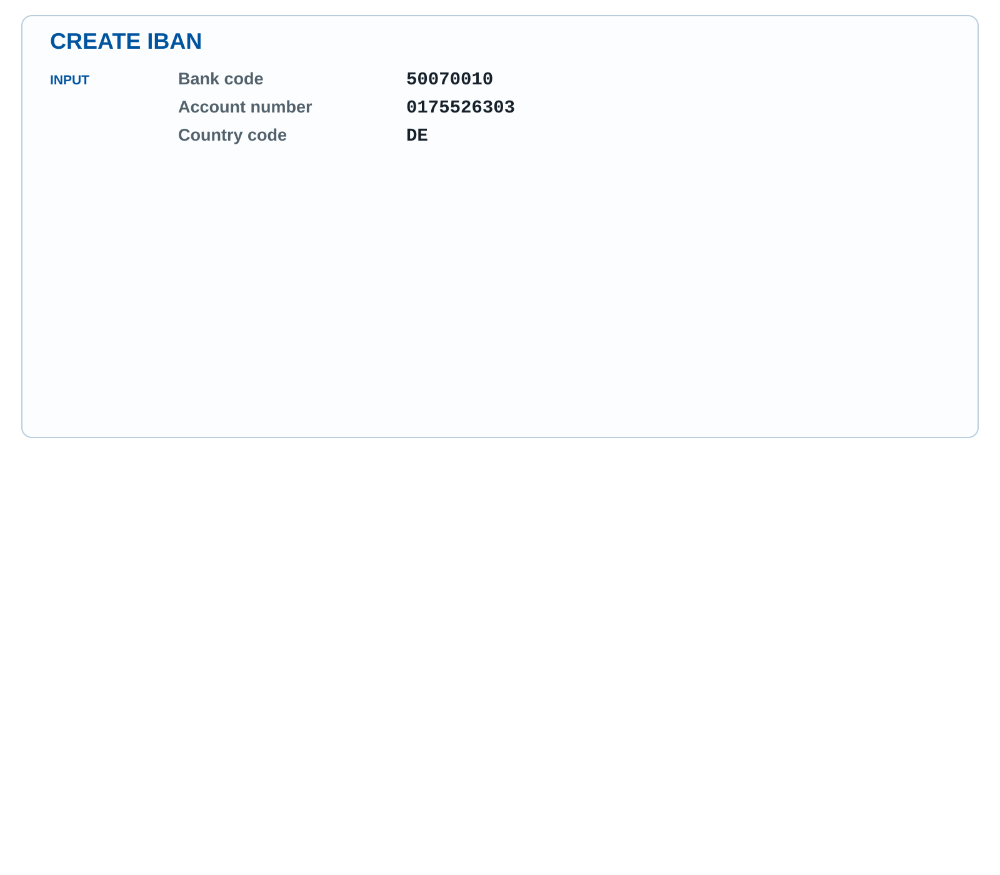
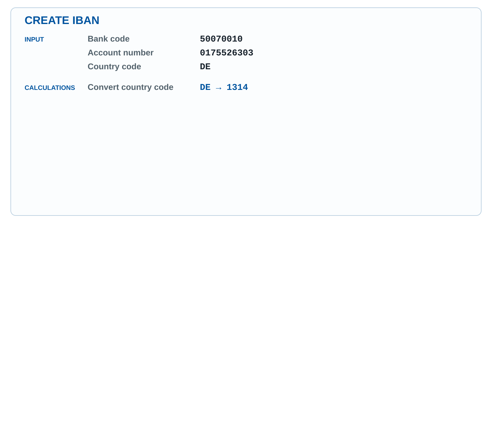
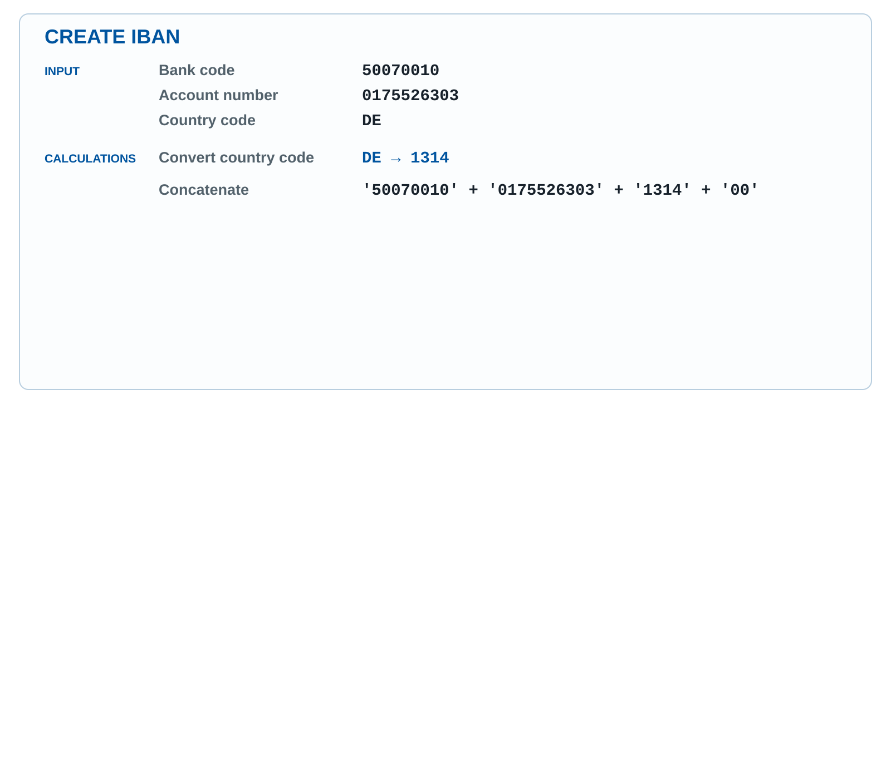
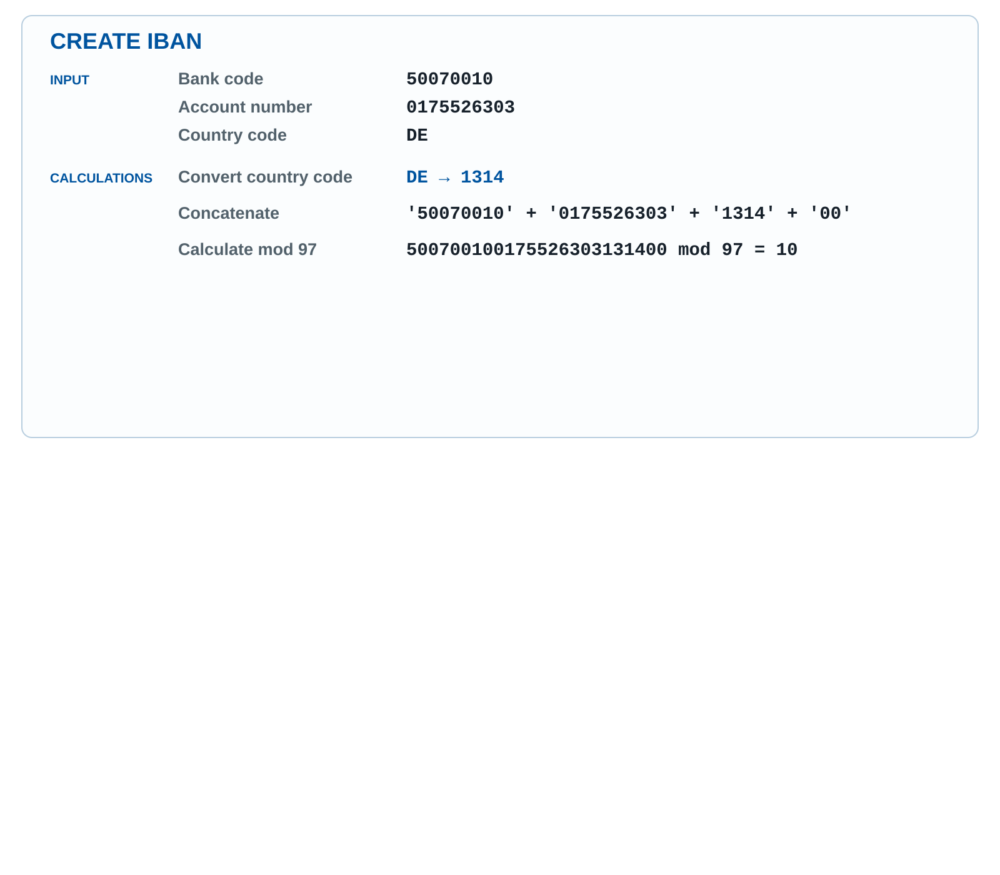
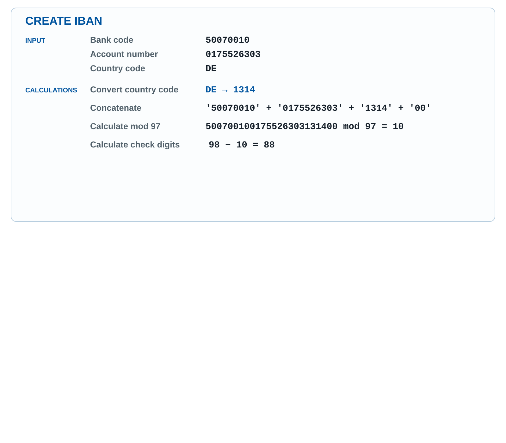
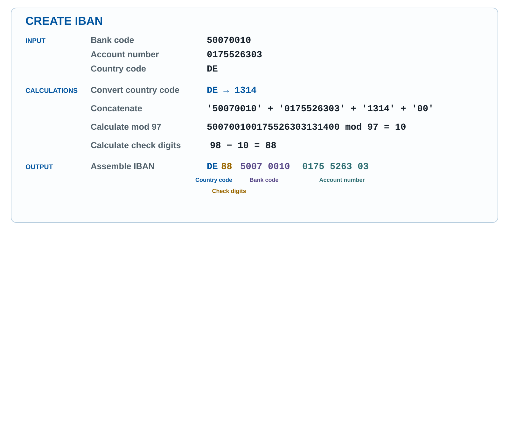
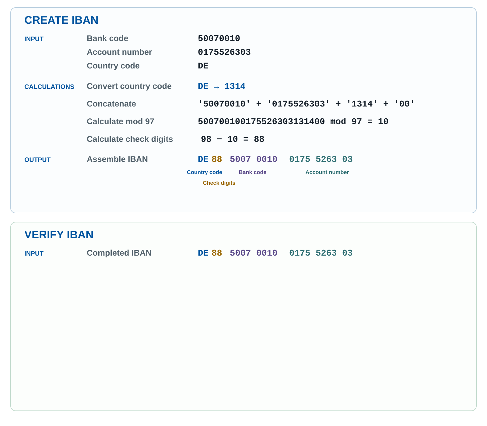
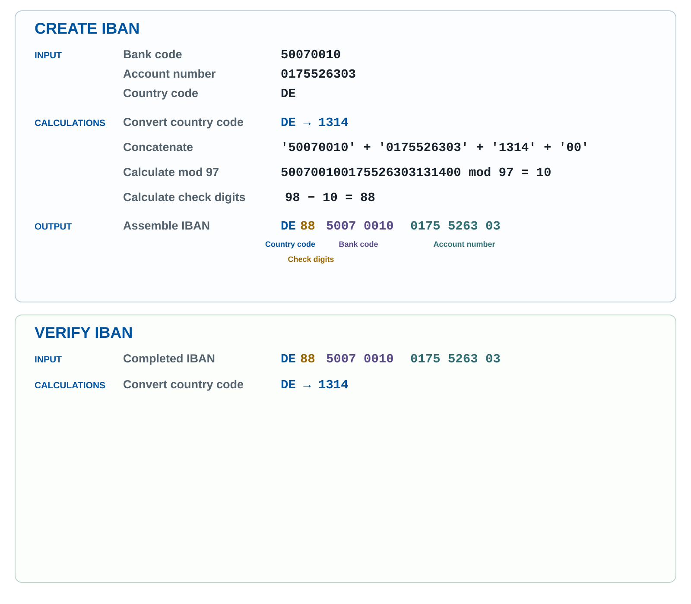
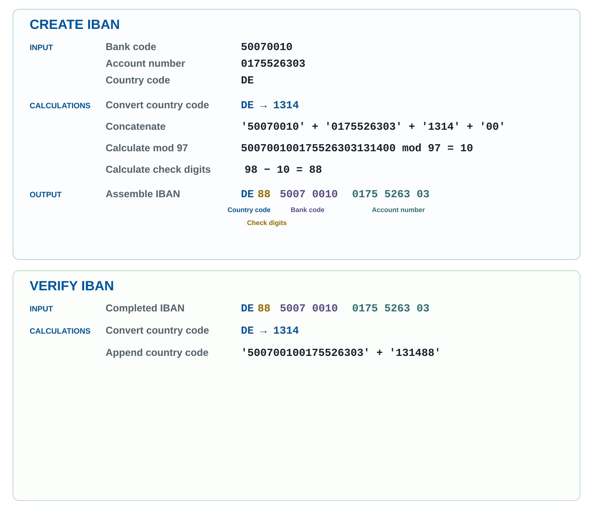
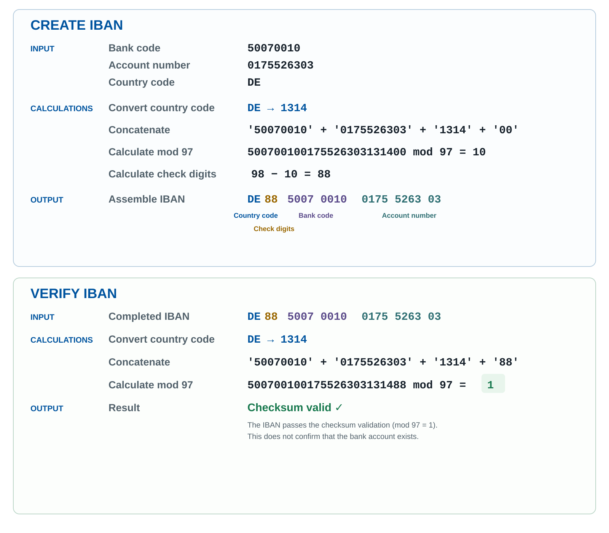

```{=html}
<style>
  .reveal .iban-stage-stack {
    position: relative;
    width: 100%;
    height: 1340px;
    overflow: visible;
  }

  .reveal .iban-stage-stack > img {
    position: absolute;
    inset: 0;
    display: block;
    width: 100%;
    height: 100%;
    max-width: none;
    max-height: none;
    margin: 0;
    object-fit: contain;
  }

  .reveal .iban-standard-link {
    position: absolute;
    z-index: 20;
    left: 50%;
    bottom: 0.15rem;
    transform: translateX(-50%);
    color: #00549F;
    font-size: 16px;
    font-weight: 600;
    line-height: 1.2;
    text-decoration: underline;
    white-space: nowrap;
  }

  .reveal .iban-continue-button {
    position: absolute;
    z-index: 20;
    right: calc(100% + 1rem);
    top: 50%;
    transform: translateY(-50%);
    display: inline-flex;
    flex-direction: row;
    align-items: center;
    justify-content: center;
    gap: 0.65rem;
    width: max-content;
    max-width: min(24rem, calc(100vw - 2rem));
    box-sizing: border-box;
    padding: 0.9rem 1.25rem;
    border: 1px solid rgba(0, 84, 159, 0.3);
    border-radius: 999px;
    background: rgba(255, 255, 255, 0.94);
    box-shadow: 0 2px 10px rgba(0, 35, 70, 0.14);
    color: #00549F;
    font: inherit;
    font-size: 22px;
    font-weight: 600;
    line-height: 1.2;
    text-align: center;
    cursor: pointer;
  }

  .reveal .iban-continue-button:hover,
  .reveal .iban-continue-button:focus-visible {
    background: #fff;
    border-color: #00549F;
    box-shadow: 0 3px 14px rgba(0, 35, 70, 0.22);
  }

  .reveal .iban-continue-button:focus-visible {
    outline: 3px solid rgba(0, 84, 159, 0.35);
    outline-offset: 3px;
  }

  .reveal .iban-continue-button kbd {
    padding: 0.12rem 0.4rem;
    border: 1px solid rgba(0, 84, 159, 0.25);
    border-radius: 0.3rem;
    background: #f1f6fa;
    color: #17466c;
    font: inherit;
    font-size: 0.85em;
  }
</style>

<div class="iban-stage-stack">
  

  

  

  

  

  

  

  

  

  

  <button class="iban-continue-button" type="button" aria-label="Click or press Space to continue">
    <span>Click or press <kbd>Space</kbd> to continue</span>
    <span aria-hidden="true">→</span>
  </button>

  <a
    class="iban-standard-link"
    href="https://www.iso.org/standard/81090.html"
    target="_blank"
    rel="noopener noreferrer">Based on ISO 13616-1:2020 — IBAN structure</a>
</div>

<script>
  window.addEventListener('load', () => {
    const button = document.querySelector('.iban-continue-button');
    const fragments = document.querySelectorAll('.iban-stage-stack .fragment');
    const lastFragmentIndex = Math.max(
      ...Array.from(fragments, (fragment) => Number(fragment.dataset.fragmentIndex || 0))
    );

    const updateButton = () => {
      button.hidden = (Reveal.getIndices().f || 0) >= lastFragmentIndex;
    };

    button.addEventListener('click', () => {
      if ((Reveal.getIndices().f || 0) < lastFragmentIndex) Reveal.next();
    });

    Reveal.on('ready', updateButton);
    Reveal.on('fragmentshown', updateButton);
    Reveal.on('fragmenthidden', updateButton);
    Reveal.on('slidechanged', updateButton);
    updateButton();
  });
</script>
```
