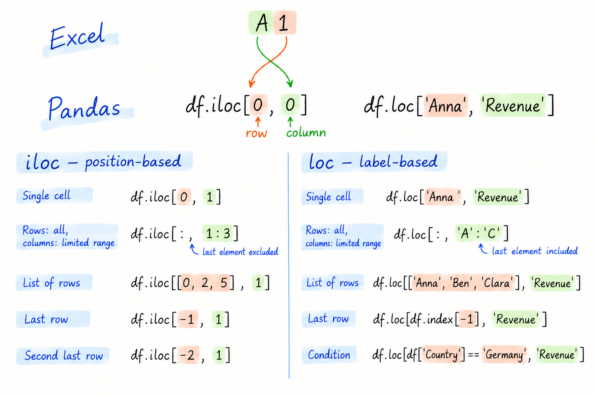
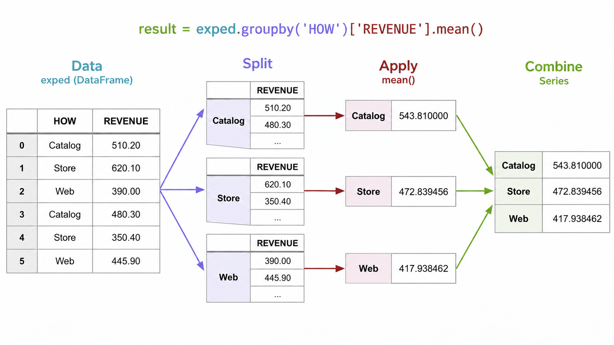

Take notes separately on the solutions discussed with the students in this track.

::: {.callout-tip title="Track solution progress"}
After each session, use the **Python solution coverage** forms immediately after the Groups section near the beginning of the printed teaching notes. For each track, check completed teaching files and add broader notes as needed. Share the updated progress with that track's tutor and tick the session's **Shared with tutor** checkbox. The forms are generated from all `teaching-file` includes in Sessions 06–11; progress is recorded on paper.
:::

::: {.callout-note title="Datasets"}
- **`data.zip`**: `Exped.xlsx`
- **`Python_exercises`**: `countries.csv`, `temperatures.csv`, `insurance.xlsx`
:::

Focus on descriptive statistics, basic charts (line, bar), filtering, and grouping. Other materials are complementary.

```{mermaid}
%%| fig-width: 5

flowchart

  subgraph AFTER_BREAK["<b>After break: Filter and group data</b>"]
    direction TB
    B1["<b>Boolean conditions and row filtering</b> (20 min)"]
    B2["<b>Combined conditions</b> (15 min)"]
    B3["<b>💻 Exercise: Conditional filtering</b> (20 min) · countries.csv, filter_countries.py"]
    B4["<b>Grouping by one or more columns</b> (15 min)"]
    B5["<b>💻 Exercise: Group countries and insurance</b> (17 min) · countries.csv, group_by_countries.py, insurance.xlsx, summarize_insurance.py"]

    B1 --> B2 --> B3 --> B4 --> B5
  end

  subgraph BEFORE_BREAK["<b>Before break: Summarize and visualize data</b>"]
    direction TB
    A0["<b>Solve homework (countries)</b> (10 min)"]
    A1["<b>Sum, mean, SD, correlation</b> (20 min)"]
    A2["<b>Summaries, unique values, and frequencies</b> (15 min)"]
    A3["<b>💻 Exercise: Countries descriptive stats</b> (15 min) · countries.csv, summary_stats_countries.py"]
    A4["<b>Line, bar, and pie charts</b> (30 min)"]
    A5["<b>💻 Exercise: Countries visualizations</b> (10 min) · countries.csv, visualize_countries.py"]

    A0 --> A1 --> A2 --> A3 --> A4 --> A5
  end

```



## Homework (Slide 36)

::: {.teaching-file}
[`../materials/data/countries.csv`](../materials/data/countries.csv){.teaching-button .teaching-button-exercise}
:::



<br>

**Quick refresher after the mid-term break and exams**

Briefly revisit how to select rows and columns in Pandas using `.iloc` and `.loc`.

{width=80%}

In the following, we increasingly work with the assumption that we cannot look at all of the data (like in Excel).
Instead, we use functions to calculate statistics or to visualize data (exploratory data analysis).



## Slide 37 — Summing DataFrame values

In the following, it is a general approach to select DataFrames (columns and rows) before running statistical functions or visualizations.

selecto expressions calculate the same sums using label-based and position-based selection.

```{python}
import pandas as pd

exped = pd.read_excel("../materials/data/Exped.xlsx")

# display first:
exped.loc[:, 'REVENUE']
exped.loc[:, 'REVENUE'].sum()
```

```{python}
exped.loc[:, ['QUANTITY', 'REVENUE']].sum()
exped.iloc[:, 5:7].sum()
```


## Slide 39 — Mean, standard deviation, and correlation

```{python}
exped.loc[:, ['QUANTITY', 'REVENUE']].mean()
```

```{python}
exped['REVENUE'].std()
```

```{python}
exped.loc[:, ['QUANTITY', 'REVENUE']].corr()
```



## Slide 40 — Statistical summaries

`describe()` is type-aware, so its summary depends on whether the selected data are numerical or categorical.

```{python}
exped.describe()
```

```python
exped['REVENUE'].describe()
```

```python
exped['WHERE'].describe()
```

## Slide 41 — Unique values and frequencies

```{python}
exped['WHERE'].unique()
```

```{python}
exped['WHERE'].value_counts()
```



## Slide 42 — Exercise on descriptive statistics


**Mean** measures the average value of a dataset (sensitive to outliers).

$$
\bar{x} = \frac{1}{n} \sum_{i=1}^{n} x_i
$$

- $x_i$: Individual observation
- $n$: Number of observations

**Variance** measures how spread out values are around their mean. A higher variance indicates greater variability, while a variance of zero means all values are identical.
It is calculated as:

$$
s^2 = \frac{1}{n-1} \sum_{i=1}^{n} (x_i - \bar{x})^2
$$

where:

- $x_i$: Individual observation
- $\bar{x}$: Sample mean
- $n$: Number of observations
- $n-1$: Degrees of freedom (corrects for estimating the population mean from the sample)

Variance is expressed in **squared units** of the original data. The standard deviation ($s = \sqrt{s^2}$) converts it back to the original units.


::: {.teaching-file}
[`../materials/data/countries.csv`](../materials/data/countries.csv){.teaching-button .teaching-button-exercise}
:::



## Slide 43 — Creating a basic chart

::: {.callout-note title="Switch Spyder display"}
Use `Alt`+`Shift`+`PgUp` to switch Spyder display (activating the plot area).
:::

With no explicit column selection, `plot()` includes all numerical columns by default.

::: {.teaching-file}
[In-class demo]{.teaching-label .teaching-label-demo} [`../materials/data/temperatures.csv`](../materials/data/temperatures.csv){.teaching-button .teaching-button-demo}
:::

```{python}
import pandas as pd

temps = pd.read_csv("../materials/data/temperatures.csv")
temps.head()
```

```{python}
temps.plot()
```



## Slide 44 — Selecting variables for a chart

Focus on Temperature (exclude rainfall). Reiterate `iloc[:, 1:4]` (0 and 4 excluded).

```{python}
temps.iloc[:, 1:4].plot()
```

Update X axis

```{python}
temps.plot(
    x='Month',
    y=['Maximum', 'Average', 'Minimum'],
)
```



## Slide 45 — Formatting the x-axis

```python
temps.plot(
    x='Month',
    y=['Maximum', 'Average', 'Minimum'],
    xticks=range(len(temps)),
    rot=75,
)
```

## Slide 47 — Creating a bar chart

```{python}
df = exped['WHERE'].value_counts()
print(df)
```

```{python}
df.dtypes
```

```{python}
df.plot(kind='bar')
```



## Slide 48 — Creating pie charts

```{python}
df.plot(kind='pie', y='WHERE')
df.plot(kind='pie', subplots=True)
df.plot(kind='pie', subplots=True, legend=True)
```



## Slide 49 — Basic visualizations

We assume that `Country` contains unique values.
Counting rows is equivalent to counting unique countries.

::: {.teaching-file}
[`../materials/data/countries.csv`](../materials/data/countries.csv){.teaching-button .teaching-button-exercise}
:::



::: {.callout-important title="Exam relevance"}
Only line and bar plots are relevant to the exam; see the document listing exam-relevant topics.
:::

::: {.teaching-break}
Break — 10 minutes
:::

## Slide 50 — Creating a Boolean condition

The comparison produces a Boolean Series with one value per row.

```{python}
exped.WHERE == 'London'
```

## Slide 51 — Selecting rows based on a condition

```{python}
exped.loc[exped.WHERE == 'London']
```



## Slide 52 — Combining conditions

Use `&` for “and” and `|` for “or”. Each condition needs parentheses when conditions are combined.

**Task:** Display transactions in London with a revenue exceeding 2500.

```{python}
exped.loc[
    (exped.WHERE == 'London') & (exped.REVENUE >= 2500)
]
```



**Task:** Display transactions in with quantity greater 5 and revenue exceeding 2500.

```{python}
exped.loc[
    (exped.QUANTITY >= 5) | (exped.REVENUE >= 2500)
]
```

Note: The "pre-selected" DataFrames can be used to run statistical functions or plots.



## Slide 53 — Conditional filtering

::: {.teaching-file}
[`../materials/data/countries.csv`](../materials/data/countries.csv){.teaching-button .teaching-button-exercise}
:::



- Connect filtering conditions to the resulting summaries and visualizations.



## Slide 54 — Grouping by one column

Inspect DataFrame `exped` and explain the goal of the analysis first.

```{python}
exped.groupby('HOW')['REVENUE'].mean()
```

Develop the illustration on the whiteboard (using different colors to match the parts of the formula and illustration):



Highlight:

- Aggregation functions reduce rows. Variables that are not part of the aggregation will be removed.
- Grouping-parameter could be an individual column, or multiple columns.
- Pandas does not conveniently print the contents of the `groupby()` call.
  Therefore, it is important to develop a good understanding of what the function calls do.

<!--
https://courses.cs.washington.edu/courses/cse163/26sp/lessons/lesson10-groupby/
-->




## Slide 55 — Grouping by multiple columns

```{python}
a = exped.groupby(['HOW', 'WHERE'])['REVENUE'].mean()
a
```

**Highlight: resembles Excel PivotTables.**



## Slide 56 — Grouping and aggregation

::: {.teaching-file}
[`../materials/data/countries.csv`](../materials/data/countries.csv){.teaching-button .teaching-button-exercise}
:::



::: {.teaching-file}
[`../materials/data/insurance.xlsx`](../materials/data/insurance.xlsx){.teaching-button .teaching-button-exercise}
:::



- Demonstrate grouping with both the country and insurance datasets.



## Summary and announcements

- Survey (QR code)

::: {.callout-tip title="Notes for improvement"}
Take notes on improvements and common questions during the session and add them to `feedback.qmd` afterwards.
:::

See the Python solution coverage forms after **Groups** at the beginning of the printed teaching notes.
