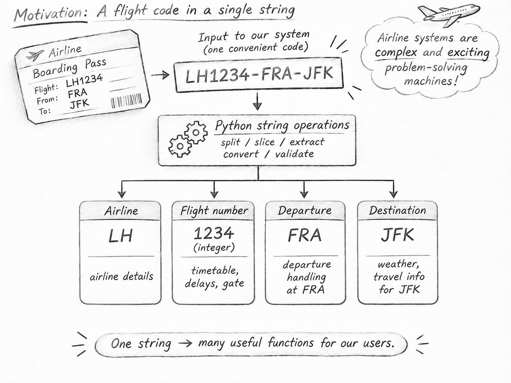

- Info on grading status?
- Add the link to the IBAN procedure, make it available to students? (canvas?)
- Info: solutions are available on Canvas

```{mermaid}
%%| fig-width: 6

flowchart

  subgraph AFTER_BREAK["<b>After break: Conditional logic</b>"]
    direction TB
    B1["<b>Conditional branches</b> (30 min)"]
    B2["<b>💻 Exercise: Odd/even</b> (15 min)"]
    B3["<b>💻 Exercise: Discount</b> (13 min)"]
    B4["<b>💻 Exercise: Dice game, block placement</b> (10 min)"]
    B5["<b>💻 Exercise: Temperature</b> (10 min)"]
    B6["<b>Conditional homework and wrap-up</b> (12 min)"]
    B1 --> B2 --> B3 --> B4 --> B5 --> B6
  end

  subgraph BEFORE_BREAK["<b>Before break: Strings and sequences</b>"]
    direction TB
    A1["<b>Strings: creation and slicing</b> (20 min)"]
    A2["<b>💻 Exercises: Strings 1–2</b> (20 min) · 3: homework"]
    A3["<b>💻 Exercise: IBAN</b> (12 min)"]
    A4["<b>Lists: creation and slicing</b> (15 min)"]
    A5["<b>💻 Exercise: List 1</b> (10 min) · 2: homework"]
    A6["<b>Tuples and mutability</b> (13 min)"]
    A1 --> A2 --> A3 --> A4 --> A5 --> A6
  end

```



## Slide 88 — Creating strings: Airline ticket example



**Motivation:** Airline systems are complex problem-solving systems. They manage flight schedules, airports, routes, check-in, and much more. Often, information arrives as a single string rather than separate values.

Use a simplified flight ticket identifier as a running example:

```python
ticket = "LH1234-FRA-JFK"
```

The ticket arrives as one string, but different airline systems need different
pieces of information. Before passing those pieces on, first check that the
ticket has the expected basic structure.

**Checking the ticket**

```python
ticket = "LH1234-FRA-JFK"

type(ticket) == str        # True
len(ticket) == 14          # True
ticket[6] == "-"           # True
ticket[10] == "-"          # True
```

These checks confirm that the value is a string with the expected length and
that the separators are in the expected positions. They are individual checks
for now; conditional statements will show later how a program can respond to
the results.

### Informational reminder: quotes and printing

Both single and double quotes can mark a string:

```python
ticket = 'LH1234-FRA-JFK'   # Single quotes
ticket = "LH1234-FRA-JFK"   # Double quotes
```

Use different quote styles when the text itself contains a quotation mark:

```python
message = 'Flight "LH1234" is ready'
print(message)
```

Repeating a string can also be useful for a visual separator in printed output:

```python
print("-" * 30)
```

## Slide 89 — Accessing characters

Indexing lets us check individual positions in the ticket and access individual
characters:

```python
ticket = "LH1234-FRA-JFK"

ticket[0]       # 'L' (first character)
ticket[1]       # 'H'
ticket[4]       # '3'
ticket[6]       # '-' (first separator)
ticket[-1]      # 'K' (last character)
ticket[-3]      # 'J'
```

**Key points:**

- Indexing starts at zero.
- Negative indices count from the end.
- Individual characters are themselves strings.
- The digits in the ticket are initially characters, not numerical values.

## Slide 90 — Slicing strings

The airline, flight-number, departure, and destination systems need different
parts of the ticket. Since this ticket has a fixed structure, use slices to
extract the characters at the corresponding positions:

```python
ticket = "LH1234-FRA-JFK"

airline = ticket[:2]       # 'LH'
flightnr = ticket[2:6]     # '1234'
departure = ticket[7:10]   # 'FRA'
destination = ticket[11:14]  # 'JFK'
```

Imagine passing `airline` to the airline subsystem, `flightnr` to the flight
subsystem, and the two airport codes to the departure and destination systems.

**Activate prior Pandas knowledge:** Ask students to compare `ticket[2:6]`
with position/range-based access using `.iloc`. In both cases, the start
position is included and the upper limit is excluded. Therefore, `[2:6]`
selects positions 2, 3, 4, and 5.

**Key points:**

- Slicing uses `[start:stop]`.
- The stop index is excluded.
- Missing indices mean beginning or end.
- Slices can extract parts that can be routed to different systems.

**Prepare the flight number for numerical processing**

The flight subsystem may need the flight number as a number for calculations.
The slice is a string, so convert it before numerical processing:

```python
flightnr = ticket[2:6]       # '1234'
flightnr_number = int(flightnr)  # 1234

type(flightnr)               # str
type(flightnr_number)        # int
```

**Membership tests**

Use `in` to check whether a sequence of characters occurs in the ticket:

```python
"FRA" in ticket       # True
"BER" in ticket       # False
"JFK" not in ticket   # False
```

String membership can provide a quick check for a particular code. The
position-based slices above are useful when the ticket follows a known fixed
structure.



## Slides 91–92 — Exercises: Strings and IBAN

1. Write a Python program to calculate the length of a string you type in. Furthermore, it should output the first and the last character.



2. Write a Python program to insert a string in the middle of a string.





**Assign exercise 3 (maybe 4) as homework.**

3. Write a program that at first asks for two strings...





4. The International Bank Account Number (IBAN) is a standardized international numbering system developed to identify bank accounts across national borders....

**Illustrate logic**

- Remember: validation steps applied in the airline example. For critical input, we may also want to avoid typos.
- **How could we know?** -> checksum!
- Standard: [ISO 7064](https://www.fisg.it/funzioni/php-iban/docs/ISO13616.pdf).
- Use the visualization: [IBAN construction and verification](https://fs-ise.github.io/introduction-to-programming/materials/session_08/iban.html). **Highlight that the task is to implement the last part: IBAN validation.**
- We want the completed IBAN to leave a remainder of 1 when divided by 97. During creation, we calculate the current remainder and determine how much must be added to reach 98—the next number with remainder 1. During verification, we simply check whether the completed number indeed has remainder 1.
- Why `mod 97` ? - Two digits available. Low numbers accept more errors (especially single-digit typos).
- Remember to do proper splitting, concatenation, and type conversions (`mod` requires int).
- Note: **Country code conversion is not part of the task** (assume users enter `1314` instead of `DE`).



<br>







## Slide 93 — Creating lists: Managing flights

**Motivation:** Airlines manage collections of flights, not just individual tickets. Flights are added, canceled, or rescheduled. We need a data structure that can store and modify multiple values.

```python
flights = [
    "LH1234-FRA-JFK",
    "LH5678-FRA-LHR",
    "LH9012-FRA-CDG",
    "LH3456-FRA-JFK",
]

type(flights)       # list
len(flights)        # 4
```




## Slide 94 — Indexing and slicing lists

The **same indexing and slicing principles apply** to strings and lists.

```python
ticket[0]           # 'L' (first character of the ticket string)
flights[0]          # 'LH1234-FRA-JFK' (first element of the flight list)

flights[-1]         # Last flight
flights[1:3]        # Second and third flights
flights[:2]         # First two flights
flights[2:]         # Third flight onward
```

**Key points:**

- Indexing starts at zero; negative indices count from the end.
- Slicing uses `[start:stop]`; the stop index is excluded.
- Indexing returns one element; slicing returns a new list.

**Membership and combining lists**

```python
"LH1234-FRA-JFK" in flights    # True
"LH7777-FRA-MAD" in flights    # False

# This fails: + combines a list and a string
flights + "LH123-FRA-JFK"      # TypeError

# Put the new flight in a list before combining
flights + ["LH123-FRA-JFK"]
flights # not modified - how could we actually change flights?
flights = flights + ["LH123-FRA-JFK"]
```

Explain that `+` combines two lists and creates a new list. The example that
fails helps highlight that a flight identifier is a string, while `flights` is
a list.

## Slide 96 — Managing flight schedules

Airline staff need to add and schedule flights. Start with methods that add
one or more flights or place a flight at a particular position:

```python
flights = ["LH1234", "LH5678", "LH9012"]

# Schedule one new flight
# more convenient than the `flights = flights + [...]`!
flights.append("LH3456")

# Add multiple flights
flights.extend(["LH7777", "LH8888"])

# Notice: append/extend add new elements at the end
# Insert a **special flight** at the first position
flights.insert(1, "LH9999")
```

These methods **modify the existing list**, unlike `flights + ["LH3456"]`,
which creates a new list. This is a good point to introduce mutability: list
elements can be reassigned, whereas strings cannot be changed character by
character.

```python
flights[0] = "LH1111-FRA-JFK"  # Replace the first flight

ticket = "LH1234-FRA-JFK"
ticket[0] = "A"                 # TypeError: strings are immutable
```

Continue with methods for locating flights, changing their order, and removing
them:

```python
flights = ["LH1234", "LH5678", "LH9012", "LH1234"]

# Change the order
flights.reverse()

# Find the position of a flight
flights.index("LH5678")    # 2 (after reversing the list)

# Count occurrences
flights.count("LH1234")    # 2

# Cancel a flight
flights.remove("LH5678")

# Remove the last flight and return it
flights.pop()

# Remove all flights
flights.clear()
```

**Key points:**

- `index()` returns the position of the first matching element; it raises an error if the element is missing.
- `count()` returns the number of occurrences.
- `reverse()` modifies the list in place.
- `remove()` removes the first matching element; it raises an error if the element is missing.
- `pop()` removes and returns an element (the last one by default).
- `clear()` empties the list.

### Lists inside lists: Managing bookings

Appending a list to `flights` adds that whole list as one element. This is
usually unintended when `flights` is meant to contain flight identifiers:

```python
flights = ["LH1234-FRA-JFK", "LH5678-FRA-LHR"]
flights.append(["LH7777-FRA-MAD", "LH8888-FRA-CDG"])

flights[-1]       # A list of two flight identifiers, not one flight
```

However, a list inside another list is useful when one record groups related
values, such as a flight identifier and its ticket price:

```python
bookings = [
    ["LH1234", 450],
    ["LH5678", 320],
    ["LH9012", 580],
]

bookings[0]         # ['LH1234', 450]
bookings[0][1]      # 450 (ticket price)
```

**Takeaway:** Lists share indexing, slicing, and membership operations with
strings. Unlike strings, lists can be modified, and they can contain other
lists when related values belong together.

**Ticket prices: built-in functions**

```python
prices = [450, 320, 580, 290]

len(prices)         # 4 (number of prices)
min(prices)         # 290 (cheapest ticket)
max(prices)         # 580 (most expensive ticket)
```



## Slide 97 — Listexercise 1





## Slide 97 — Listexercise2: Homework





## Slide 98 — Mutable vs immutable types: the case of tuples

Indexing and slicing are similar for tuples and lists.

```python
tuple1 = ('physics', 'chemistry', 1997, 2000)
tuple2 = (1, 2, 3, 4, 5)
tuple3 = ("a", "b", "c", "d")
tuple4 = ((1, 2, 3, 4), (5, 6, 7, 8))

tuple1[1]
tuple2[2:4]
tuple4[1][2:4]
```



## Slide 99 — Mutable lists and immutable tuples

```python
mylist = [1, 2, 3, 4]
mytupel = (1, 2, 3, 4)

print(mylist)
print(mytupel)

mylist[2] = 5
print(mylist)

mytupel[2] = 5 # raises a TypeError: 'tuple' object does not support item assignment
```

::: {.teaching-break}
Break — 10 minutes
:::



## Slide 104 — Conditional statements

### Motivation: From processing information to making decisions

Opening question: "So far, our programs have processed information by following instructions. But how can a program react differently depending on the information it receives?"

Return to the airline ticket example:

```python
ticket = "LH1234-FRA-JFK"
destination = ticket[-3:]

if destination == "JFK":
    print("Flight to New York")
```

Key points:

- `destination == "JFK"` evaluates to `True` or `False`.
- The `print()` statement only executes when the condition is true.
- We have introduced a new way to control which instructions Python executes.

Pedagogical moment: Change `JFK` to `LHR`. Ask students to predict the output before running the code.

### Understanding how Python executes statements

Motivation: To understand conditionals, we first need to understand how Python executes a program.

#### 1\. Sequential execution

Python normally executes statements one after another, from top to bottom.

```python
ticket_price = 450
tax = 50
total = ticket_price + tax
print(total)
```

#### 2\. A statement can involve several operations

Executing an individual statement may involve multiple operations.

```python
price = 450
print("Ticket price: " + str(price) + " EUR")
```

Walk through the evaluation:

- Retrieve the value of `price`.
- Convert the integer `450` into the string `"450"`.
- Concatenate the strings.
- Call `print()` with the resulting string.

Key distinction: A statement is not necessarily a single computational operation. Python evaluates the expressions needed to execute it.

#### 3\. A statement may span multiple physical lines

```python
print(
    "Flight: LH1234",
    "Departure: FRA",
    "Destination: JFK"
)
```

Although this occupies five lines, it is one Python statement.

Python recognizes the statement as continuing across lines because the parentheses remain open.

Pedagogical moment: Ask: "Does Python execute five separate print statements here?" Emphasize the difference between physical lines and logical statements.

#### 4\. Compound statements introduce blocks

Now revisit the conditional:

```python
destination = "JFK"

if destination == "JFK":
    print("Flight to New York")
    print("International destination")
    print("Check travel requirements")

print("Processing complete")
```

Explain the execution process:

1. Python evaluates the Boolean condition.
2. If `True`, it executes the statements in the indented block, one after another.
3. If `False`, it skips the entire indented block.
4. Execution continues with the first statement after the block.

The important point of compound statements is that one part (the `if`) controls whether other statements are executed.


```{mermaid}
%%| fig-height: 2.5
 
flowchart TD
    A["destination = 'JFK'"]
    B{"destination == 'JFK'?"}
    C["Execute indented block<br/>3 print statements"]
    D["Processing complete"]

    A --> B
    B -->|True| C
    B -->|False| D
    C --> D

    classDef statement fill:#eef1f5,stroke:#94a3b8,color:#222
    classDef decision fill:#e2e8f0,stroke:#6486a8,color:#222
    classDef executed fill:#dceee5,stroke:#27835f,color:#222

    class A,D statement
    class B decision
    class C executed
```

Pedagogical moments:

- Ask students to identify exactly which statements are inside the `if` block.
- Change the condition to `False` and ask which statements are skipped.
- Dedent the third `print()` and ask how the execution changes.
- Emphasize that indentation is part of Python's syntax, not merely a formatting convention.

Key takeaway: Python executes statements sequentially, but compound statements such as `if` control which blocks of statements are executed.

### Choosing between alternatives: `if / else`

Motivation: Sometimes we need the program to execute one block or another, rather than simply execute or skip a block.

```python
ticket = "LH1234-FRA-JFK"

if len(ticket) == 14:
    print("Correct length")
    print("Continue processing")
else:
    print("Invalid length")
    print("Request correction")

print("Validation finished")
```

Explain that `if` and `else` each have their own indented block. Only one of these blocks executes, and the program then continues after the entire conditional structure.

Pedagogical moments:

- Ask whether both blocks could ever execute in the same pass through this `if/else`.
- Show how changing the length of the ticket changes the execution path.
- Ask whether a ticket with the correct length is necessarily valid.

Key takeaway: `if/else` represents two mutually exclusive execution paths.

### Multiple alternatives: `if / elif / else`

Motivation: Airline systems may apply different rules depending on ticket prices.

```python
price = 450

if price < 200:
    print("Budget")
elif price < 500:
    print("Standard")
else:
    print("Premium")

print("Classification complete")
```

Explain that Python evaluates conditions in order and executes the block associated with the first true condition. The remaining branches are skipped.

Pedagogical moments:

- Ask why `elif price < 500` does not also require `price >= 200`.
- Compare the behavior of `if/elif/else` with three independent `if` statements.
- Test `price = 200`, `499`, and `500`.

Key takeaway: In an `if/elif/else` chain, Python selects at most one branch. The order of conditions matters.

### Combining conditions: Boolean operators

Motivation: Business decisions often depend on multiple requirements being satisfied simultaneously.

```python
price = 450
seats_available = True

if price <= 500 and seats_available:
    print("Booking possible")
else:
    print("Booking not possible")
```

Introduce `and`, `or`, and `not` as ways to combine or negate Boolean conditions.

Pedagogical moments:

- Ask whether changing `and` to `or` would preserve the intended booking rule.
- Evaluate `price <= 500` and `seats_available` independently before combining them.
- Explain that Python evaluates Boolean expressions using short-circuit evaluation, without exploring the implementation in depth.

Key takeaway: Boolean operators allow us to express decision rules involving multiple conditions.

<!--
### Consolidation: Predict the execution path

End with a short exercise combining the main concepts:

```python
price = 550
seats_available = True

print("Checking booking")

if price <= 500:
    print("Price accepted")
    if seats_available:
        print("Booking possible")
else:
    print("Price too high")

print("Check complete")
```

Ask students to determine the output without running the program.

Then discuss:

- The two separate levels of indentation.
- Why the nested `if` does not execute.
- Why the final `print()` always executes.
- How changing `price` to `450` changes the execution path.

This also briefly introduces nested conditionals, without requiring extensive coverage.
-->

## Summary

1. Sequential execution: Python normally executes statements in order; a single statement may involve multiple operations or span several lines.
2. Conditional execution: An `if` statement evaluates a Boolean condition to decide whether an entire indented block executes.
3. Alternative paths: `else` and `elif` provide additional branches; only the first matching branch executes.
4. Logical conditions: Comparisons and Boolean operators express business rules.
5. Control flow and indentation: Indentation determines which statements belong to a block; statements following the block resume normal execution.

Conditional statements do not replace sequential execution; they control which sequences of statements Python executes.



## Slides 105–107 — Exercises on conditional logic. Homework: 3, 5, 6, 7

1. Write a program to determine if a number entered is odd or even.



2. Write a program that calculates a discount based on the purchase amount.



3. Extend the program which calculates the annual payment of an annuity loan by a rating parameter.





4. Write a program that simulates a dice game.

**Explain exercise 4, emphasizing the importance of whether code is inside/outside an `if` block.**



5. Write a program to convert temperatures between celsius and fahrenheit.



6. Write a program to calculate the grades A-F based on the final percentage score:



7. Write a program to calculate income tax (T) and net income for any taxable income (X)



## Summary and announcements

- Survey

::: {.callout-tip title="Notes for improvement"}
Take notes on improvements and common questions during the session and add them to `feedback.qmd` afterwards.
:::

See the Python solution coverage forms after **Groups** at the beginning of the printed teaching notes.
