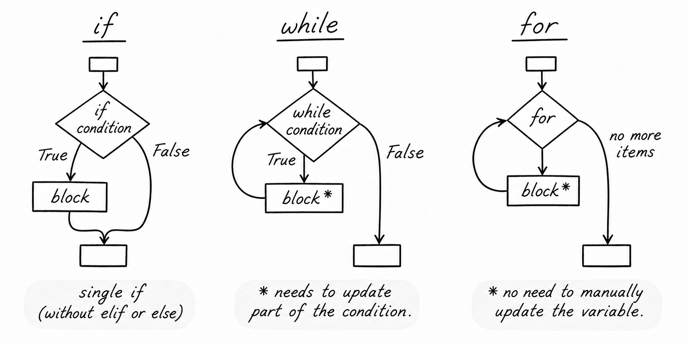
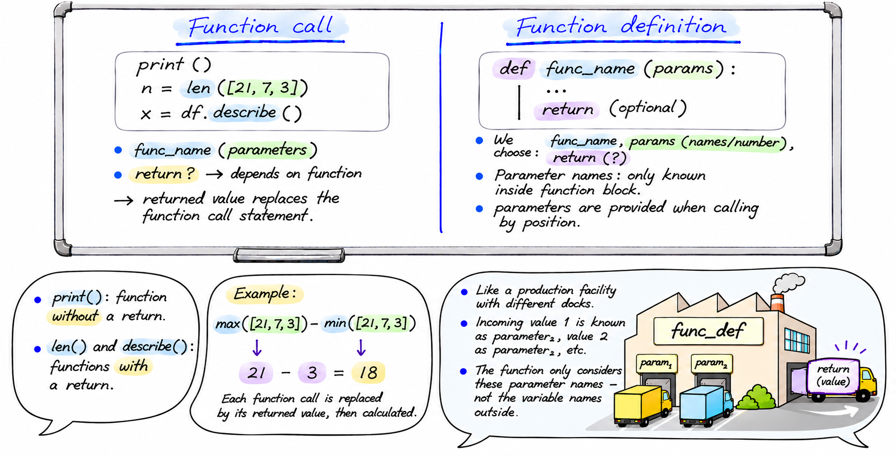

PREP TODO: Upload [InsuranceAgent.pdf](../materials/session_10/InsuranceAgent.pdf) to Canvas.

::: {.callout-important title="Exam relevance"}
- Functions: at least one problem set in the exam.
- Dictionaries: less relevant for the exam (do not explicitly announce as not relevant at the beginning) - maybe as multiple-choice.
:::

```{mermaid}
%%| fig-width: 6

flowchart

  subgraph AFTER_BREAK["<b>After break: Functions</b>"]
    direction TB
    B1["<b>First function: print information</b> (10 min)"]
    B2["<b>Calculate and return a value</b> (15 min)"]
    B3["<b>Reuse and compose functions</b> (15 min)"]
    B4["<b>💻 Exercises: Count digits and factorial</b> (25 min)"]
    B5["<b>💻 Exercises: Combinations and slot machine</b> (20 min)"]
    B6["<b>External modules and review</b> (5 min)"]
    B1 --> B2 --> B3 --> B4 --> B5 --> B6
  end

  subgraph BEFORE_BREAK["<b>Before break: Control flow, loop control, and dictionaries</b>"]
    direction TB
    A1["<b>Control-flow recap: if, while, for</b> (5 min)"]
    A2["<b>break and continue: airline seats</b> (20 min)"]
    A3["<b>💻 Loop-termination exercises</b> (35 min) · Dice-game extension homework"]
    A4["<b>Dictionary access and updates</b> (20 min)"]
    A5["<b>Lookup efficiency and recap</b> (10 min)"]
    A1 --> A2 --> A3 --> A4 --> A5
  end

```



## Control-flow recap — `if`, `while`, and `for`

{width=90%}

Use the illustration as a recap and highlight that loop control focuses on the loop blocks (highlight them).

<!-- ## Slide 115 — `break` and `continue` -->

Emphasize that the compound statements `if`, `while` and `for` control the flow of execution.
In the following, we focus on statements that allow us to control the block execution in `for` and `while`:

- `continue` skips the rest of the current iteration and continues with the next
- `break` terminates the loop

For example, when looking for an available airline seat, `continue` skips seats
that are taken, and `break` stops the search as soon as a free seat is found:

```python
seat_statuses = ["taken", "taken", "free", "free"]

for seat_status in seat_statuses:
    print("Checking", seat_status)

    if seat_status == "taken":
        continue

    print("Assigning the first free seat")
    break  # add break as the last element (without it, we continue to assign seats to the passenger
```

Variations:

```python
for ...:
    ...
    # additional if:
    if "y" != input("Passenger accepts"):
        continue
```

Ask what happens if every seat is taken: the loop finishes without assigning a seat.

::: callout-note
Show slide p. 115 (right side).
:::

**Exercise**: The same search can be written with a `while` loop.

Hint: Use an index to retrieve items.
Remember to update the index before `continue` so the loop moves on to the next seat:

```python
seat_statuses = ["taken", "taken", "free", "free"]
seat_index = 0

while seat_index < len(seat_statuses):
    seat_status = seat_statuses[seat_index]
    print("Checking", seat_status)
    seat_index = seat_index + 1

    if seat_status == "taken":
        continue

    print("Assigning the first free seat")
    break)
```

**Predict the output of these code blocks**

```{python}
for val in "string":
    if val == "i":
        break
    print(val)

print("The end")
```

```{python}
for val in "string":
    if val == "i":
        continue
    print(val)

print("The end")
```



## Slide 116 — Loop termination

1. Extend the code to end the loop when the user enters 0.



2. Expand the dice game again.

Assign exercise 2 as homework.





::: {.callout-tip title="Attention: Learn to analyze and implement requirements"}
In this task, we learn to systematically analyze requirements and
identify the corresponding programming constructs:

- **Interactive input:** Does the task require users to enter information?
  → Use `input()`.
- **Repetition:** Does an operation (e.g., entering information) need
  to be repeated?
  - If the number of repetitions is known → Use a `for` loop.
  - If repetition depends on a condition → Use a `while` loop.
- **Accumulation:** Does a result need to be calculated across multiple
  iterations (e.g., a sum or count)?
  → Initialize and update an accumulator variable.

Before writing code, analyze the task description for these patterns
and determine how the programming constructs should be combined.
:::

Task instruction: [InsuranceAgent.pdf](../materials/session_10/InsuranceAgent.pdf), uploaded on Canvas





## 127-128 Dictionary illustration

The same flight can be represented as a list or a dictionary. The access and
update statements highlight the difference: a list uses numeric positions, while
a dictionary uses descriptive keys.

### List: position-based access and updates

```python
flight_9012 = ["BER", "FRA", "boarding"]

print(flight_9012[0])
flight_9012[2] = "delayed"
```

### Dictionary: key-based access and updates

```python
flight_9012 = {
    "destination": "BER",
    "departure": "FRA",
    "status": "boarding",
}

print(flight_9012["destination"])
flight_9012["status"] = "delayed"
```

In the list, position `0` contains the destination and position `2` contains
the status. In the dictionary, the keys make those roles explicit. Assigning to
an existing key updates its value; assigning to a new key adds an entry.

::: {.callout-note title="Teaching note: efficient, label-based lookup"}
- **Efficient lookup:** A dictionary retrieves a value by a known key without
  scanning through its entries (typically O(1) on average). Searching a list for
  a matching value may require checking items one by one (O(n)); direct list
  access by numeric position remains efficient.
- **Explicit, robust selection:** A meaningful key, such as `"destination"`,
  makes the intended value clear and remains stable if a list is reordered. A
  key that does not match an entry raises `KeyError`; an incorrect but valid list
  index can instead silently select a different value.
:::

::: {.callout-note title="Teaching note: Pandas connection"}
Invite students to notice the conceptual parallel with the label-based Pandas
axes they have used: a label identifies the value or row of interest. Keep this
as a brief verbal connection, with no additional code example; a Pandas index
is not simply a Python dictionary.
:::

::: {.teaching-break}
Break — 10 minutes
:::



## Slide 118 — Defining functions



### First function: print information

This function prints information and does not explicitly return a value:

```python
def show_flight_information(flight):
    print("Flight:", flight)
    print("Please proceed to your gate.")


show_flight_information("LH1234-FRA-JFK")
```

::: callout-tip
Running just the function definition does not print anything. It only makes the function available.
:::

### A function that calculates and returns a value

Explain that `return` sends a result back to the caller. The caller can store
the result or use it in another calculation.

```python
def square(number):
    result = number * number
    return result


number = 5
squared_number = square(number)
print("Square:", squared_number)
```



## Slide 120 — Reusing functions

Compare the repeated inline calculation `a * a + b * b` with calling
`square(a)` and `square(b)`. A named function makes the operation easier to
read, update, and reuse. Then show one function calling another:

Motivation: sum of squares to assess performance of predictions.

Start with simple square function:

```python
def square(number):
    return number * number

# Test call
print(square(2))

# Continue with additions
total_for_two_numbers = square(2) + square(3)
print(total_for_two_numbers)
```

Then introduce the loop to sum up and wrap it in a function:

```python
def sum_of_squares(numbers):
    total = 0

    for number in numbers:
        total = total + square(number)

    return total


numbers = [1, 2, 3, 4, 5, 6, 7, 8, 9, 10]
total = sum_of_squares(numbers)

print("Sum of squares:", total)
```



## Slides 121–122 — Functions

Order, in-session: 1, 4, 5, 6 (if time permits).
Assign 2,3 as homework.

1. Write a function count_digits(int)



2. Write a Python function to multiply all the numbers in a list.





3. Write a function isHarshad(int)



4. Write a Python function to calculate the factorial of a number (n!).



**Remember**: `range(..., stop)` : the stop value is excluded. Therefore, iterate to `n+1` (exclusively).



5. Extend the program by adding a function which calculates the number of possible combinations



6. Write a program that simulates a slotmachine



## Slide 125 — Using an external module

Modify one of the previous scripts to move the function out into a separate file (module) and import it.

The module name acts as a namespace prefix.

```python
import math

print(math.sin(5))
print(math.sin(math.pi))
```



## Summary and announcements

- `if` chooses a path, while `while` and `for` repeat work.
- `continue` skips the rest of one loop iteration; `break` exits the loop.
- Lists access items by position; dictionaries access values through keys and
  can add or update entries.
- Functions can print information or return a value for later use.

Looking back at the Python sessions: You already know a lot.
With the `if`, `for`, `while`, function definitions etc., you understand 60-70% of the code in a Python project.
If you want to know more (beyond the course), you may look at class definitions or exception handling.

::: {.callout-tip title="Notes for improvement"}
Take notes on improvements and common questions during the session and add them to `feedback.qmd` afterwards.
:::

See the Python solution coverage forms after **Groups** at the beginning of the printed teaching notes.
